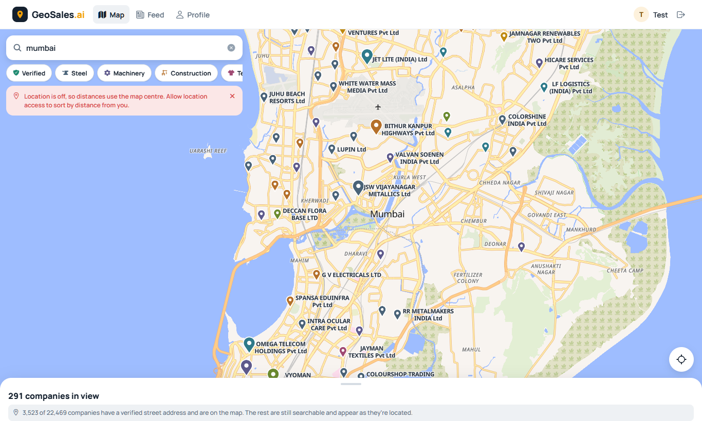
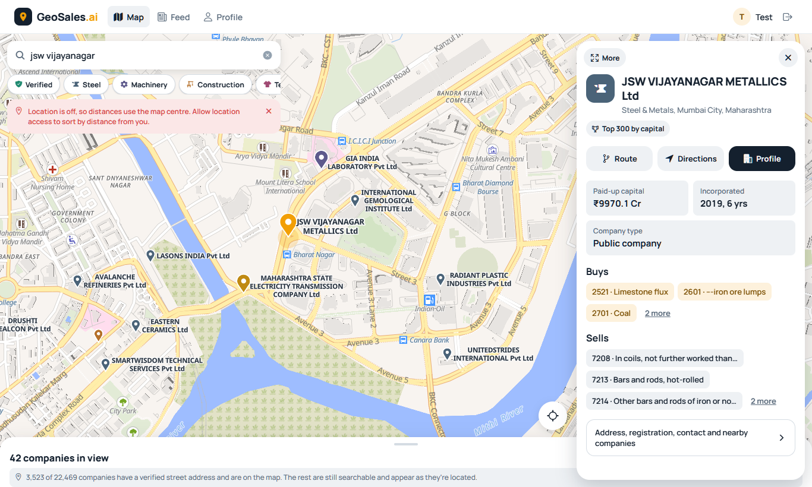
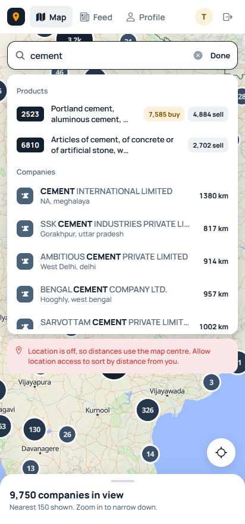
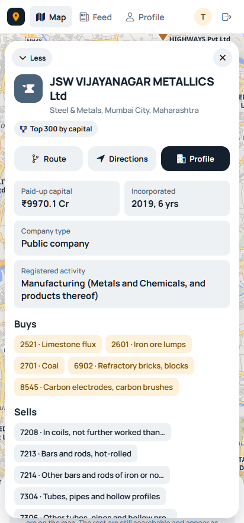

<div align="center">


<a href="https://git.io/typing-svg"></a>

<br/>


</div>

---

## What Is This Project?

A salesman flies into Pune for a 9 AM meeting. It ends at noon; the flight home is tomorrow. **GeoSales.ai turns that afternoon into meetings** — it shows every nearby company that *buys what they sell*, ranked by size, with the facts needed before walking through the door.

It has two connected parts:

| Module | What it does |
|--------|--------------|
| **Field sales map** | Companies on a live map, filtered by industry and product, with a detail panel for each: paid-up capital, incorporation year, what it buys and sells (by HSN code), registration numbers, and one-tap route or directions. A rep's own ERP clients appear as private red pins. |
| **B2B feed** | Companies post launches, case studies and offers. Active posters rank higher on nearby reps' maps — the incentive that keeps company data fresh. |

The same codebase runs on **web, Android and iOS** (Expo + React Native Web).

> **Current status:** 22,469 real companies from the Ministry of Corporate Affairs (MCA) register. **3,523 are on the map** with building- or street-level positions verified against their pincode; the rest are searchable and appear as their addresses are located. 19,579 HSN product categories. Map, search, company profiles and ERP import are working; feed and meetings are early.

---

## Screenshots

<div align="center">

| City view — biggest companies first | Company panel |
|---|---|
|  |  |

| Search on phone | Panel on phone |
|---|---|
|  |  |

</div>

---

## Features

- **Ranked map pins, Google-Maps style** — at country zoom only the largest companies (by MCA paid-up capital) are shown with names; smaller ones appear as you zoom in. No clutter of count bubbles.
- **Honest locations** — a company is pinned only when its registered address resolves to a building or street *and* matches its pincode. No city-centre or district fallbacks.
- **Company panel** — expandable side panel (bottom sheet on phones): capital, age, public/private, registered activity, Buys / Sells by HSN code, address and location precision, CIN / GSTIN, contacts, nearest companies.
- **"Buys what you sell" badge** — matches a rep's product list against each company's purchase categories using the HSN hierarchy.
- **Search** — typo-tolerant (`tata stel` → Tata Steel), by product or HSN (`cement`, `7213`), or by city; product results filter the map to every company that buys or sells it.
- **Industry filters** — chips for each industry, verified-only, my-clients toggle.
- **ERP import** — upload a quotation Excel; columns are auto-detected and customers become private client pins with last order, date and value.
- **Routing** — in-app road route (OSRM) plus hand-off to Google / Apple Maps for turn-by-turn.

---

## Architecture

```
            ┌──────────────────────────────────────────────┐
            │  Expo app  (web · Android · iOS)             │
            │  expo-router · Zustand · Reanimated          │
            │  MapLibre GL (web) / MapLibre Native         │
            └───────────────┬──────────────────────────────┘
                            │ REST + JWT (refresh in httpOnly cookie / SecureStore)
            ┌───────────────▼──────────────────────────────┐
            │  Express API  (Docker: geosales_api :3000)   │
            │  auth · map · companies · upload · feed      │
            └──────┬──────────────────────┬────────────────┘
                   │                      │
   ┌───────────────▼─────────┐   ┌────────▼───────────────────────┐
   │ PostgreSQL 16 + PostGIS │   │ Photon geocoder (local, :2322) │
   │ geosales_db :5432       │   │ OpenStreetMap India extract    │
   │ GIST · pg_trgm · FTS    │   └────────────────────────────────┘
   └─────────────────────────┘
        external: OpenFreeMap vector tiles · OSRM routing
```

### How a company gets on the map

```
MCA register (data.gov.in)
  │  scripts/fetch-mca-api.js → import-mca.js
  ▼
companies (address, pincode, paid-up capital, CIN …)
  │  scripts/classify-mca-companies.js → Buys / Sells HSN categories
  │  scripts/geocode-photon.js
  ▼
Photon query variants:  full address · building name + city · street + city
  │
  ▼  accept only if:
     building/house match  (POI named in the address or after the company,
                            or house number on a street named in the address)
     or street match       (road named in the address)
     AND pincode matches   (or the building is literally named after the company)
     AND within 40 km of the company's city
  ▼
geocode_precision = house | street   →  pinned
                  = locality | none  →  searchable, not pinned
```

### Pin ranking

Companies are tiered by paid-up capital — tier 1 is the top 300, then 3,000, 10,000 and the rest. Each tier gets its own MapLibre symbol layer with a minimum zoom (0 / 6 / 8.5 / 10.5), and within a layer pins are sorted by rank. MapLibre's collision detection then keeps the bigger company wherever two pins would overlap.

### Search scoring

```
candidates = trigram word-similarity on name   (legal suffixes like "Pvt Ltd" removed first)
           ∪ companies buying/selling a matching product category (name, keyword or HSN prefix)

text  = 0.6 · similarity²  + 0.3 · prefix  + 0.5 · exact  + 0.25 · product match
score = text · (0.75 + 0.25 / (1 + km / 50)) · feed visibility
ties → larger paid-up capital first
```

Squaring similarity suppresses weak substring hits ("cement" inside "manage**ment**"); distance only breaks ties, so a far exact match still beats a near partial one.

---

## Project Structure

```
/
├── backend/                     # Express API (runs in Docker)
│   ├── server.js                # App setup: middleware, routers, listen
│   ├── config.js                # All env vars with dev defaults
│   ├── routes/                  # auth · map · companies · upload · users · feed · meetings
│   ├── middleware/auth.js       # JWT auth, roles, optional auth
│   ├── services/                # geocode (Photon), routing (OSRM), ERP parser
│   ├── db/
│   │   ├── init.sql
│   │   └── migrations/          # 001 … 014, applied in order
│   ├── scripts/                 # data pipeline — see below
│   ├── data/                    # MCA downloads (gitignored)
│   └── uploads/                 # user files (gitignored)
│
├── mobile/                      # Expo app — web, Android, iOS from one codebase
│   ├── app/                     # expo-router screens: (tabs)/map, feed, profile · company/[id] · auth
│   ├── components/map/          # MapViewWeb, MapViewNative, CompanyPanel, SearchPanel, ResultsSheet
│   ├── stores/                  # Zustand: mapStore, authStore
│   ├── hooks/ · utils/ · services/
│   └── constants/               # theme tokens, industries, API endpoints
│
├── geocoder/                    # Photon jar + India DB (gitignored — see geocoder/README.md)
├── docs/                        # DATABASE.md, TECHSTACK.md, images
├── scripts/                     # start.ps1 (Windows) · start.sh (macOS / Linux)
├── start.cmd                    # Windows double-click wrapper for scripts/start.ps1
├── docker-compose.yml           # Postgres + API (production target)
├── docker-compose.override.yml  # dev: live-mounted source + nodemon
└── Makefile                     # docker shortcuts
```

---

## Getting Started

Setup works on **Windows, macOS and Linux**. Pick your platform in each step.

### Prerequisites

| Requirement | Version | Used for |
|-------------|---------|----------|
| Git | any | Clone the repo |
| Docker | Docker Desktop (Windows / macOS) or Docker Engine + Compose plugin (Linux) | PostgreSQL + PostGIS, API |
| Node.js | 20 LTS or newer | Expo app |
| Java | 21 or newer | Photon geocoder — only needed to geocode new addresses |
| Disk | ~2 GB free | `node_modules` + India map data |

<details open>
<summary><b>Windows</b> (PowerShell, using winget)</summary>

```powershell
winget install Git.Git
winget install Docker.DockerDesktop
winget install OpenJS.NodeJS.LTS
winget install EclipseAdoptium.Temurin.21.JDK
```
Restart the terminal afterwards so the new commands are on `PATH`, and start Docker Desktop once to finish its setup (it uses WSL 2).
</details>

<details>
<summary><b>macOS</b> (Homebrew)</summary>

```bash
brew install git node@20 openjdk@21
brew install --cask docker
open -a Docker            # first launch finishes the install
```
If `java -version` doesn't find Java 21, follow the `brew info openjdk@21` note to link it.
</details>

<details>
<summary><b>Linux</b> (Ubuntu / Debian)</summary>

```bash
sudo apt update
sudo apt install -y git curl lsof openjdk-21-jre-headless bzip2
# Node.js 20 LTS
curl -fsSL https://deb.nodesource.com/setup_20.x | sudo -E bash -
sudo apt install -y nodejs
# Docker Engine + Compose plugin
curl -fsSL https://get.docker.com | sudo sh
sudo usermod -aG docker $USER      # log out and back in to use docker without sudo
```
Other distros: install the same packages with your package manager; Docker's docs cover each distro.
</details>

Check everything is ready:

```bash
git --version && docker --version && docker compose version && node -v && java -version
```

### 1 — Clone and configure

**Windows (PowerShell)**
```powershell
git clone https://github.com/Huuffy/NearBitz.git
cd NearBitz
copy backend\.env.example backend\.env
copy mobile\.env.example  mobile\.env
cd mobile; npm install; cd ..
```

**macOS / Linux**
```bash
git clone https://github.com/Huuffy/NearBitz.git
cd NearBitz
cp backend/.env.example backend/.env
cp mobile/.env.example  mobile/.env
(cd mobile && npm install)
```

Then edit `backend/.env`: set `JWT_SECRET` to a long random string and `DATAGOV_API_KEY` to your [data.gov.in](https://data.gov.in) key. `mobile/.npmrc` already sets `legacy-peer-deps`, so a plain `npm install` works.

### 2 — Set up the geocoder (once, ~1 GB)

Follow [`geocoder/README.md`](geocoder/README.md) — it has the download commands for every platform.
You can skip this to just browse the map; it's only needed to geocode new or updated addresses.

### 3 — Start everything

| Platform | Command |
|----------|---------|
| Windows | Double-click **`start.cmd`** — or `.\scripts\start.ps1` |
| macOS / Linux | `bash scripts/start.sh` |

Both scripts start Docker if needed → bring up Postgres and the API → start Photon if it isn't running → stop any running frontend and start a fresh one.

| Option | Windows | macOS / Linux |
|--------|---------|---------------|
| Clear the Metro cache | `-Clear` | `--clear` |
| Skip the geocoder | `-NoPhoton` | `--no-photon` |
| Don't open a browser | `-NoBrowser` | (never opens one) |

On macOS / Linux the frontend runs in the current terminal — `Ctrl+C` stops it; Docker and Photon keep running.

| Service | URL |
|---------|-----|
| App | http://localhost:8081 |
| API health | http://localhost:3000/health |
| Photon | http://localhost:2322 |
| PostgreSQL | `localhost:5432` · db `sales_app` |

<details>
<summary>Starting the pieces by hand</summary>

```bash
docker compose up -d                                     # Postgres + API
cd geocoder/photon_v1 && java -Xmx3G -jar photon-1.3.0.jar serve -listen-ip 0.0.0.0 -listen-port 2322
cd mobile && npx expo start --web                        # in another terminal
```
</details>

### 4 — Run on a phone (Android / iOS)

The map uses MapLibre's native module, which **Expo Go doesn't include**, so phones need a development build:

| Target | Build machine | Command (from `mobile/`) |
|--------|---------------|--------------------------|
| Android device / emulator | Windows, macOS or Linux with [Android Studio](https://developer.android.com/studio) | `npx expo run:android` |
| iPhone / iOS Simulator | **macOS only**, with Xcode | `npx expo run:ios` |

Before building for a physical device, set `EXPO_PUBLIC_API_URL` in `mobile/.env` to your computer's LAN IP (e.g. `http://192.168.1.20:3000`) so the phone can reach the API, and keep both on the same Wi-Fi.

> Opening the web app on a phone browser works too, but browsers only allow GPS on `https://` or `localhost` — over a plain LAN IP, distances fall back to the map centre.

### Troubleshooting

| Symptom | Fix |
|---------|-----|
| Backend change has no effect | On Windows, nodemon can't see changes through the Docker bind mount — `docker restart geosales_api` |
| `Photon is not reachable` when geocoding | Start Photon (step 3) and check `curl "http://localhost:2322/api?q=mumbai&limit=1"` |
| Linux: API can't reach Photon | `docker-compose.yml` maps `host.docker.internal` via `host-gateway`; make sure Photon listens on `0.0.0.0` |
| Port 8081 already in use | Re-run the start script — it stops whatever is listening there |
| `start.ps1` blocked by execution policy | Use `start.cmd`, which runs it with `-ExecutionPolicy Bypass` for that one run |

---

## Data Pipeline

Run inside the API container (`docker exec geosales_api …` or `make shell-api`):

| Step | Command | What it does |
|------|---------|--------------|
| 1 | `npm run migrate` | Apply `db/migrations/*.sql` |
| 2 | `npm run seed` | Industries + 19,579 HSN categories |
| 3 | `npm run fetch:mca` | Download the MCA company master from data.gov.in (needs `DATAGOV_API_KEY`) |
| 4 | `npm run import:mca` | Validate and load companies |
| 5 | `npm run classify` | Map MCA business activity → Buys / Sells HSN categories |
| 6 | `npm run geocode` | Street-level geocoding via Photon (resumable) |
| — | `npm run geocode:retry` | Retry companies that didn't match |

Photon is reached from the container at `http://host.docker.internal:2322` (set in `docker-compose.yml`).

---

## API Reference

| Method | Path | Auth | Purpose |
|--------|------|------|---------|
| POST | `/api/auth/register` · `/login` · `/refresh` · `/logout` | — | JWT auth with rotating refresh token |
| GET | `/api/map/all-pins` | optional | Every pinned company in compact array form (~1 MB gzipped) |
| GET | `/api/map/my-client-pins` | required | The rep's ERP clients |
| GET | `/api/map/search?q=&lat=&lon=` | optional | Grouped results: companies, products, places |
| GET | `/api/map/category-companies?category_id=&kind=buy` | optional | Company ids buying/selling a category |
| GET | `/api/map/nearby` | optional | Radius query with filters (PostGIS, max 500) |
| POST | `/api/map/route` · `/api/map/trip` | optional / required | OSRM road route · multi-stop order |
| GET | `/api/companies/:id` | optional | Full profile: Buys/Sells, MCA facts, products, posts |
| POST · PUT | `/api/companies` · `/api/companies/:id` | required | Register / update a company (address is geocoded) |
| POST | `/api/upload/erp` | required | ERP Excel import (async; poll `/api/upload/erp/:id/status`) |
| GET · PUT | `/api/users/me/products` | required | The rep's own product list (drives "Buys what you sell") |

Schema details: [`docs/DATABASE.md`](docs/DATABASE.md) · stack notes: [`docs/TECHSTACK.md`](docs/TECHSTACK.md).

---

## Configuration

`backend/.env` (template: `backend/.env.example`):

| Variable | Purpose |
|----------|---------|
| `DB_*` | Postgres connection (compose overrides host to the `postgres` service) |
| `JWT_SECRET` | **Required in production** — the dev fallback in `config.js` is not safe |
| `DATAGOV_API_KEY` | data.gov.in key for the MCA download |
| `PHOTON_URL` | Geocoder URL (`http://host.docker.internal:2322` inside Docker) |
| `OSRM_URL` | Routing server (public OSRM by default) |
| `CORS_ORIGIN` | Allowed web origins |

`mobile/.env`: `EXPO_PUBLIC_API_URL` — use your machine's LAN IP when testing on a phone.

---

## Technical Decisions

**Why a local geocoder instead of Google?**
22k addresses once, then occasional updates — a local Photon instance with the OpenStreetMap India extract does it in about 10 minutes, free, with no rate limits and no address data leaving the machine.

**Why so strict about pin precision?**
A pin a rep drives to has to be right. An earlier import placed every company at its city centre with random jitter, which looked plausible and was useless in the field. Now an address that only resolves to a neighbourhood stays off the map rather than misleading anyone.

**Why rank by paid-up capital?**
It's the only size signal available for every company in the MCA register (most aren't listed, so there is no market cap). It is real, comparable, and good enough to decide which pins to show at low zoom.

**Why GPU symbol layers instead of DOM markers?**
DOM markers are positioned with CSS transforms and lag or drift during zoom; with thousands of them the browser stutters. MapLibre symbol layers are drawn in WebGL, stay fixed to their coordinates, and come with collision detection for free.

**Why one Expo codebase?**
Reps live on phones; managers use laptops. Expo + React Native Web ships both from the same screens, with `MapViewWeb` / `MapViewNative` as the only platform split.

---

## Roadmap

- [x] 22,469 MCA companies with HSN-based Buys / Sells
- [x] Local street-level geocoding with pincode verification
- [x] Capital-ranked map pins with progressive reveal on zoom
- [x] Typo-tolerant search across names, products, HSN codes and places
- [x] Expandable company panel (web side panel, phone bottom sheet)
- [x] ERP Excel import → private client pins
- [ ] Let reps place or correct a company's pin on site — the most precise source there is
- [ ] Second geocoding pass for the 11k neighbourhood-level matches
- [ ] Plan my day — multi-stop route over selected companies
- [ ] Visit check-ins and lead status per company
- [ ] Nightly feed-visibility score job
- [ ] Offline city packs (tiles + pins)

---

<div align="center">

**Built for the rep with three free hours in a new city**


</div>
